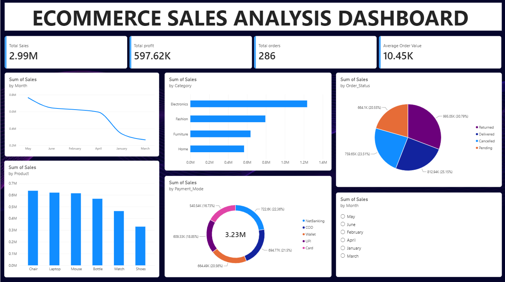

# Ecommerce Business Data Analysis

An end-to-end ecommerce analytics project that turns raw order data into
actionable business insights. The project combines Python for data cleaning
and exploratory analysis, SQL for structured business questions, and Power BI
for an interactive executive dashboard.

## Dashboard preview



The dashboard presents key performance indicators and interactive views for:

- Total sales, profit, orders, and average order value
- Sales by month, category, product, order status, and payment mode
- Product and category performance comparisons
- Monthly filtering for focused analysis

## Project workflow


1. **Business problem definition** - identify the sales and operational
   questions the analysis should answer.
2. **Data modelling and exploratory analysis in Python** - load the source
   workbook, inspect data quality, and prepare analysis-ready fields.
3. **Data analysis in SQL** - calculate sales, profit, order, product, city,
   payment, and cancellation metrics.
4. **Interactive dashboard in Power BI** - connect the prepared data and
   build visual reports for stakeholders.
5. **Project reporting** - summarize findings and recommendations.
6. **Presentation** - communicate the results using a stakeholder-ready
   presentation.
7. **Repository publishing** - keep the analysis assets, queries, and
   documentation together in GitHub.

## Business questions

This analysis is designed to answer:

- How much revenue and profit does the business generate?
- Which products and categories contribute the most sales?
- How does sales performance change by month?
- Which cities and payment methods are most important?
- What is the distribution of order statuses, including cancellations?
- Which products generate the highest total profit?

## Repository contents

| File | Description |
| --- | --- |
| `Ecommerce_Unclean_Project.xlsx` | Original source workbook |
| `Clean_Ecommerce.xlsx` | Cleaned and prepared Excel dataset |
| `Clean_Ecommerce.csv` | CSV version of the cleaned dataset |
| `Ecommerce.ipynb` | Python cleaning, transformation, and EDA notebook |
| `orders.sql` | SQL queries for the core business metrics |
| `Ecommerce_business.pbix` | Power BI dashboard file |
| `Dashboard.png` | Exported dashboard preview |
| `workflow.png` | Project workflow illustration |
| `Steps of Cleaning.docx` | Data-cleaning reference notes |

## Dataset

The cleaned dataset contains order-level ecommerce records with fields
including:

- Order and delivery dates
- Customer, city, and state
- Product and category
- Quantity, unit price, discount, sales, net amount, and profit
- Payment mode and order status
- Derived month, year, and weekday fields

The notebook derives the main financial measures using:

```text
Net Amount = Sales - (Sales × Discount / 100)
Profit = Net Amount × 20%
```

The profit calculation is an analytical assumption used for this project and
should be replaced with a real cost or margin field when one is available.

## Tools and technologies

- **Python**: pandas, NumPy, Matplotlib, and Seaborn
- **Jupyter Notebook**: data preparation and exploratory analysis
- **SQL**: aggregations and business metric queries
- **Power BI**: interactive visualization and dashboarding
- **GitHub**: project version control and documentation

## How to use

### 1. Explore the Python analysis

Open `Ecommerce.ipynb` in Jupyter Notebook or VS Code. Run the notebook from
the project root so its relative file paths resolve correctly:

```bash
jupyter notebook Ecommerce.ipynb
```

The notebook starts from `Ecommerce_Unclean_Project.xlsx` and produces the
cleaned analysis data used by the downstream SQL and Power BI steps.

### 2. Run the SQL analysis

The queries in `orders.sql` expect a table named `orders`. Load
`Clean_Ecommerce.csv` into your preferred SQL environment, then run the
queries to inspect:

- Total orders and total sales
- Top products and cities by sales
- Monthly sales
- Highest-profit products
- Orders by payment mode
- Cancelled orders

### 3. Open the Power BI dashboard

Open `Ecommerce_business.pbix` in Power BI Desktop. If prompted, update the
data source to the local cleaned dataset and refresh the model.

## Analysis outputs

The completed dashboard provides a single view for comparing commercial
performance across products, categories, months, payment methods, and order
statuses. The SQL file provides transparent, reusable definitions for the
underlying metrics, while the notebook documents the preparation steps.

## Future improvements

- Add automated data-quality checks and validation tests.
- Replace the assumed 20% profit margin with actual cost data.
- Add customer-level retention and repeat-purchase analysis.
- Track delivery time, fulfilment performance, and late deliveries.
- Automate refreshes and publish the dashboard to Power BI Service.

## License

This repository is intended for educational and portfolio use.